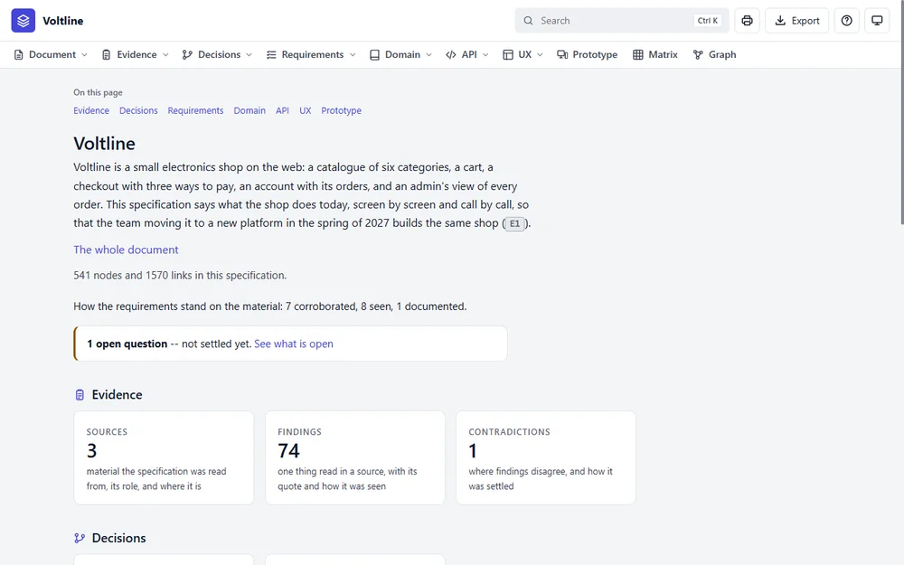
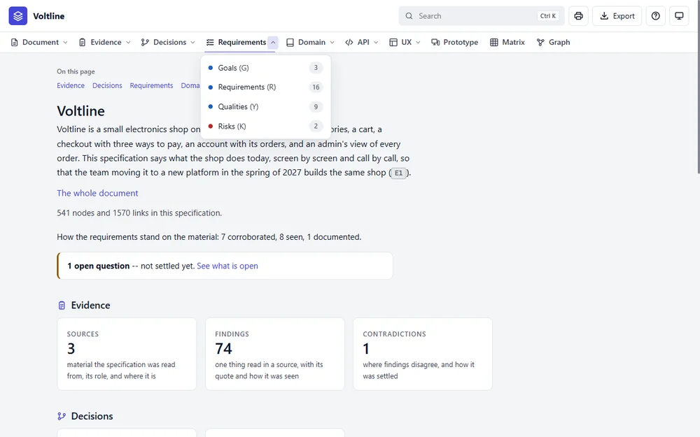
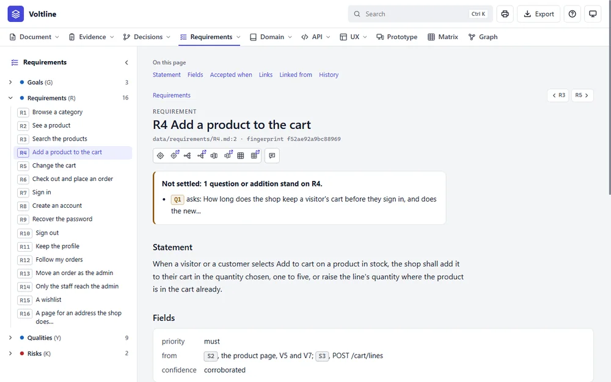
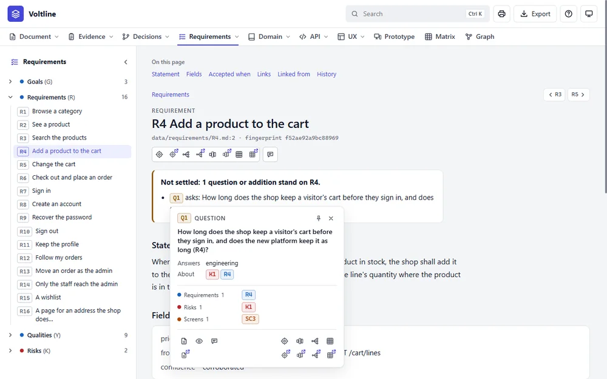
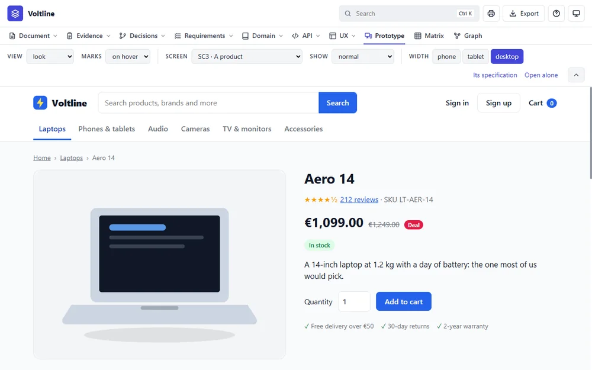
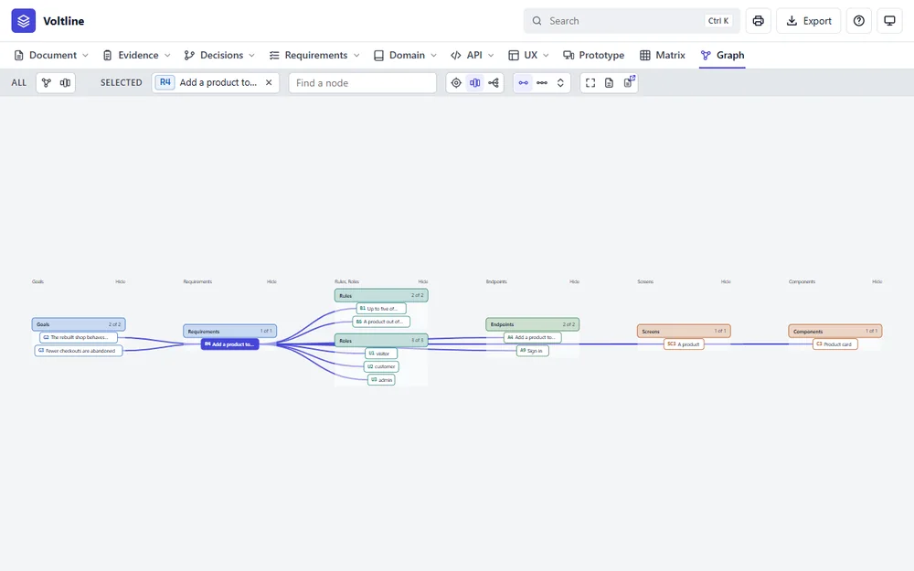
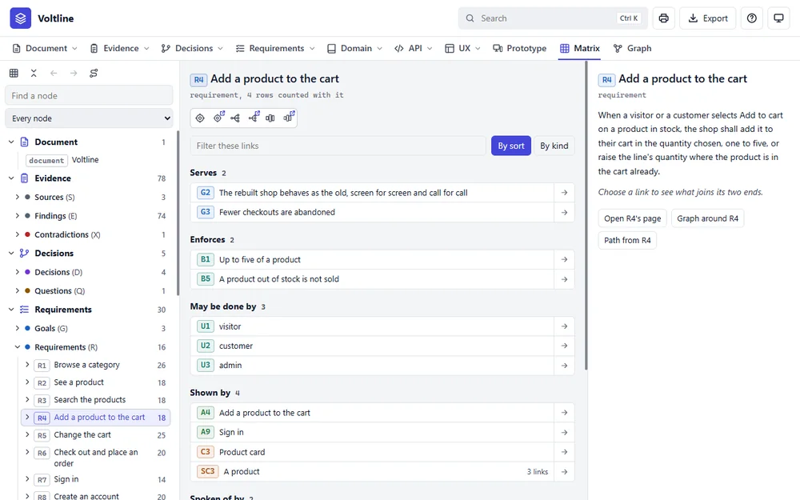
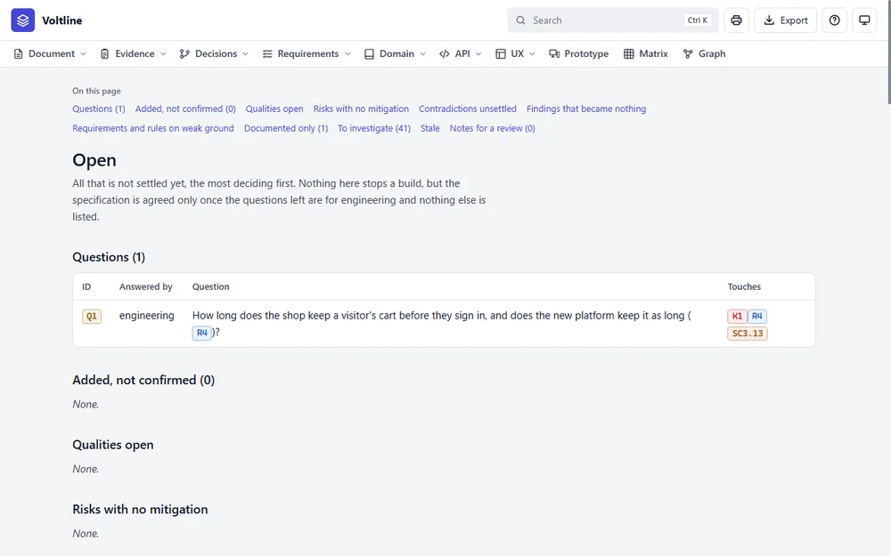
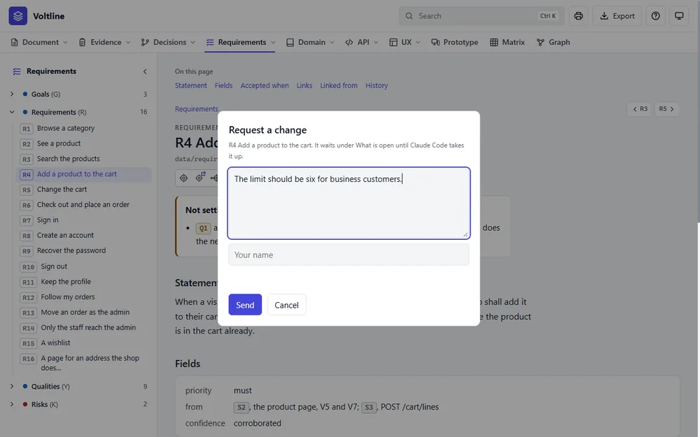

# Tutorial: your first specification

This tutorial takes you from reading a finished specification to handing over your
own. It takes about an hour, and you can stop after any part.

You'll need Python and Claude Code set up. [SETUP.md](SETUP.md) has the details.

| Part | What you'll do | Time |
|---|---|---|
| [1](#part-1-read-a-finished-specification) | Read a finished specification | 15 minutes |
| [2](#part-2-write-your-own) | Write your own with Claude | 20 minutes |
| [3](#part-3-change-it) | Change it, and see what the change affects | 10 minutes |
| [4](#part-4-finish-and-hand-it-on) | Agree it and hand it on | 10 minutes |

## Part 1: Read a finished specification

The skill comes with six finished examples. Here you'll use Voltline, a made-up
online shop. It's safe to explore, and nothing you do in the browser can change it.

Open it from the skill's folder:

| On | Run |
|---|---|
| Windows | `examples\shop\specs\index.cmd` |
| macOS, Linux | `sh examples/shop/specs/index.sh` |

### See the whole thing

Your browser opens on the overview. It says what the product is, and how much the
specification holds: here, 541 nodes and 1,570 links. A **node** is one thing the
specification says, such as a goal, a requirement or a screen. A **link** says how two
nodes connect.



### Move around

Each part in the top menu has two controls. Click the **word** to open that part's
page. Click the small **arrow** beside it to open its menu. Try it on **Requirements**.



### Read a requirement

Open **R4 Add a product to the cart**. Search finds it too: press Ctrl K and type `R4`.



Every requirement works the same way:

- **Statement:** one sentence saying what the product must do.
- **Why** and **Details:** who needs it, and what it covers. These appear only where
  someone has written them, and R4 has neither yet.
- **Accepted when:** the tests it must pass, each with its own ID, such as `R4.1`.
- **Links:** what it serves, what it enforces, and what shows it.

The toolbar under the title takes you to this node in the Graph and the Matrix. Each
icon has a twin with a small arrow, which opens the same thing in another tab. The
button on its own is **Request a change**, which you'll use in part 3.

### Find out what an ID is

IDs are everywhere, and you don't have to remember them.

- **Pause** on an ID, and a small tip says what kind of thing it is.
- **Right-click** an ID to open a card about it. Right-click an ID inside that card to
  open another beside it, and so follow a chain without leaving the page.



### Try the product before it exists

Click **Prototype** in the top menu. This is a working drawing of each screen. Change
**Screen** to move around, and **Width** to see it on a phone. The specification and
the drawing stay tied together: pick **Its specification** to see what a screen says.



### See how it connects

Open R4 again and click the third icon pair's first button, **Layers**. This shows only
what connects to R4, from the goals it serves to the components that build it.



The selected node is filled in. Then try these:

- **Click** another node to select it.
- **Double-click** a node to put it in the middle, in the Around picture.
- **Pause** on a node to light up its links.

### Check every link

Click **Matrix** in the top menu. Where the Graph shows the shape, the Matrix lists
every link. Pick a node on the left to see what it's linked to. A row can stand for
several links, such as `SC3 A product`, with `3 links`, because three parts of that
screen show R4.



### See what isn't settled

Open the **Document** menu with its arrow, and choose **What is open**. This page lists
everything that still needs a decision. A specification can't be agreed while the
important items here remain.



That's the whole of reading. Close the black window, or press Ctrl+C in the terminal,
to stop the application.

## Part 2: Write your own

Now start `claude` in your project's folder. Pick a small product you know. This
tutorial uses a booking page for a bike repair shop, but your own idea works just as
well. What you get back will differ from anyone else's, since it depends on what you
say.

### Describe it

Always say `specs-builder-2`, so that Claude uses this skill:

> Use specs-builder-2 to write a spec for a booking page for a bike repair shop.
> Customers choose a service and a free time, and the shop confirms by email.

There are two other ways to start:

| You have | Say |
|---|---|
| Only a rough goal | Use specs-builder-2 and ask me about a booking page for a bike repair shop. |
| Something that already exists | Use specs-builder-2 to reverse-engineer the folder `./my-app`. |

Claude says where it's writing, normally `docs/<your product>/specs/`. It writes
the goals, requirements and rules, then asks what it needs to know. It will ask for
permission to run commands: read each one, and approve it.

### Answer its questions

Claude keeps to two rules that matter here:

- **It won't invent facts.** Prices, opening hours, laws and numbers are asked, never
  guessed. If you don't know, say so, and it stays an open question.
- **It marks what it added.** Cases you didn't mention, such as "what if the time was
  just taken?", are written as **additions**. They aren't yours until you confirm them.

Answer in plain words. You can say "ask me that later", or:

> Confirm all the additions except the one about refunds.

### Open it

> Open the specification in my browser.

You can also run `index.cmd`, or `sh index.sh`, in the specification's folder. It's the
same application you used in part 1, now showing your product.

### Add the screens

> Use specs-builder-2. Write the flows and screens, with prototypes.

Refresh your browser when Claude finishes. Open **Prototype** and click through your
product. Seeing it usually brings up things nobody thought of, which is the point.

If you ask for something new on a screen, Claude writes the requirement first and then
draws it. So ask it to make changes, rather than editing a prototype file yourself: a
button added by hand has no requirement behind it, and nothing will notice.

## Part 3: Change it

Changes are where this approach pays off, because every link is real.

### See what a change would reach

Before changing anything, you can ask what a change would affect. Try it on the
example. From `examples/shop/specs`:

```
python app/spec.py impact R4
```

On macOS and Linux, use `python3`. It says what R4 stands on, and that 11 nodes would go
stale at once if it changed. **Stale** means "this depends on something that moved, so
read it again."

### Ask for a change

On your own specification, ask Claude:

> Use specs-builder-2. Customers should also be able to cancel a booking up to a day
> before.

Claude then:

1. Works out everything the change affects.
2. Shows you each node it would change and each screen it would redraw, and waits.
3. Makes the changes once you say yes.
4. Rereads what went stale, and confirms each one.

The application is for reading, so all changes go through Claude. That's what keeps
everything connected.

### Let others ask for changes

People reading in the browser can press **Request a change** on any node's page or card.
They say what should change, and give their name.



Nothing changes yet. The request waits under **What is open**, and it stops the
specification being agreed until someone deals with it. To deal with them:

> Use specs-builder-2. Take the requests in the inbox.

## Part 4: Finish and hand it on

### Agree it

When you think it's finished, ask:

> Use specs-builder-2. Is this ready to be agreed?

Claude lists whatever stands in the way: open questions for the product side, additions
nobody confirmed, anything stale, and requests still waiting. Work through them. When
nothing is left:

> Use specs-builder-2. Agree the specification.

Only you can agree it. Once it's agreed, it refuses changes until you set it back to
draft, so everyone knows they're reading the settled version.

### Share it

Press **Export** at the top of the application. You get one HTML file holding the whole
specification, which anyone can open with nothing to install.

### Build from it

If Claude or a developer will build the product, point them at the specification's
folder. From there, these commands give them what they need:

| To get | Run |
|---|---|
| The whole picture | `python app/spec.py overview` |
| One requirement, with all it needs | `python app/spec.py unit R4` |
| Its tests | `python app/spec.py tests R4 --gherkin` |
| A check that it's fit to build from | `python app/spec.py verify` |

## What to remember

- **Name the skill:** say `specs-builder-2` in your request.
- **The browser reads, and Claude writes.** Ask Claude for every change.
- **Read what Claude proposes** before you say yes. What's in the specification is
  yours, and it stays open until you've confirmed it.

The [user manual](USER-MANUAL.md) has everything else.
