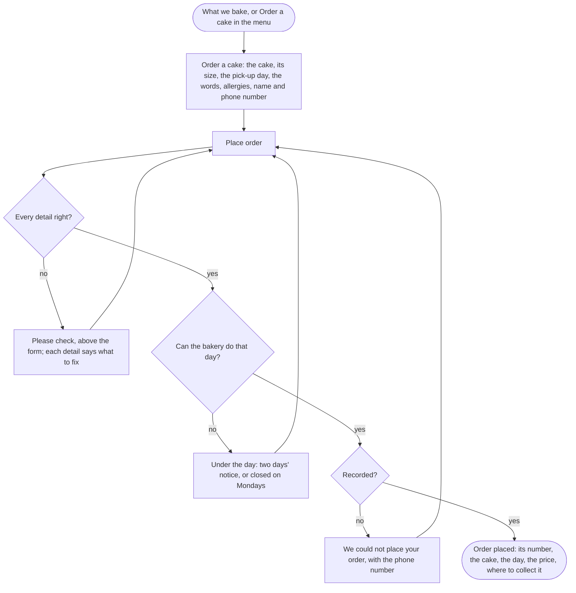

A customer ends with a cake ordered for pick-up, its number on the screen.

## Diagram

## Steps

1. The customer chooses Order this cake on What we bake, which brings the cake with it, or Order a cake in the menu. SC2, SC3, R3
2. They enter the cake, its size, the pick-up day, their name and phone number, with the words and any allergies if they want, and select Place order. SC3, R3
3. A detail missing or not accepted is refused beside it, with what they entered kept. SC3, R4
4. A day the bakery cannot do is refused under the day. SC3, R5
5. The order is recorded, and Order placed shows its number, the cake, the day, the price and where to collect it. SC4, R6
6. They collect the cake and pay at the bakery on the day they chose, outside the website.

## When it goes wrong

The order cannot be recorded: the customer is told it was not placed, with the phone number, and can send it again with nothing lost. SC3, R3
