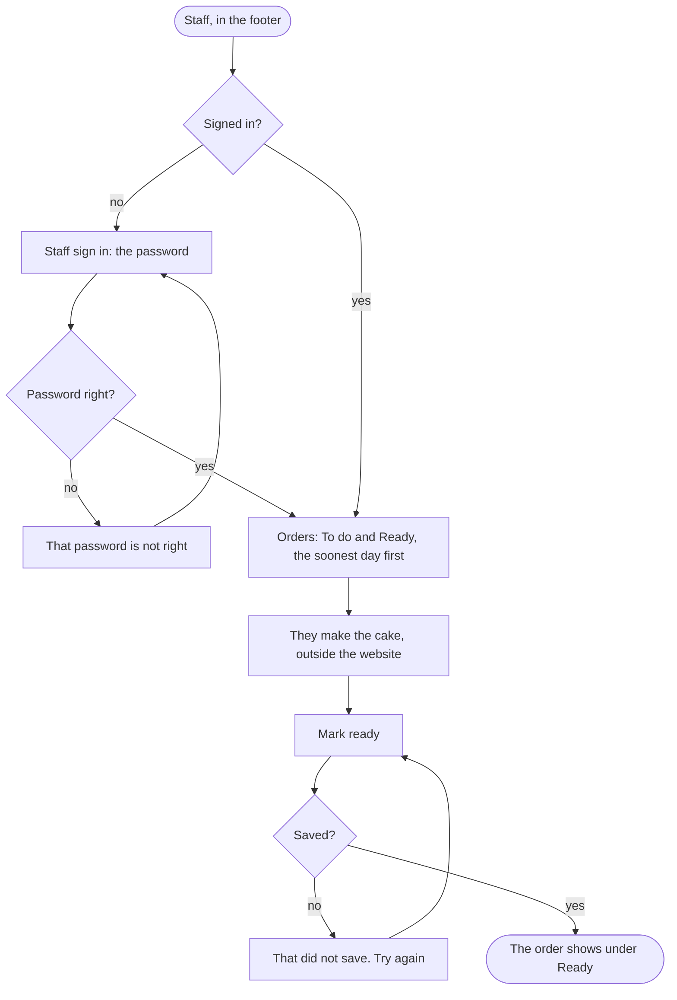

A member of staff sees the orders and marks each one ready.

## Diagram

## Steps

1. A member of staff selects Staff in the footer, and enters the staff password. SC5, R11
2. They see the orders under To do and Ready, the soonest pick-up day first; a reload shows any placed since. SC5, R9
3. They make the cake, outside the website.
4. They select Mark ready, and the order moves to Ready. SC5, R10

## When it goes wrong

The orders cannot be fetched: Orders says so, and to reload the page. SC5, R9
A mark cannot be saved: the order stays under To do and says That did not save. Try again. SC5, R10
