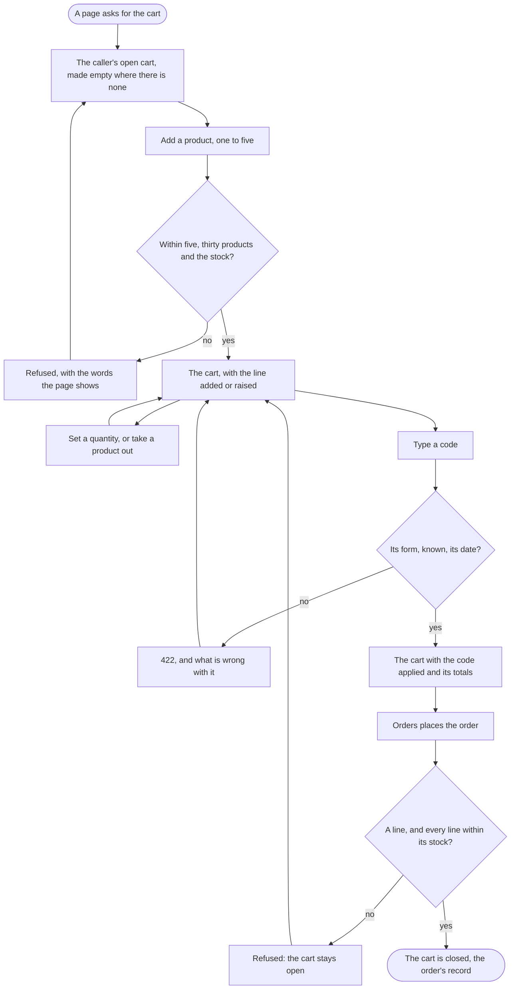

The visitor or the customer, through the shop's pages, ends with the cart they want, a code applied, and the cart closed as the order's record when the order is placed.

## Diagram

## Steps

1. The page asks for the cart; the caller's open cart is answered, made empty where there is none, each line saying whether its price changed since it was added. A1, R1, R10
2. The visitor adds a product, one to five; a sixth of it, a thirty-first product, or more than the stock is refused with its words. A2, R2
3. They set a line's quantity, and nought takes the line out. A3, R3
4. They take a product out. A4, R4
5. They type a code; it is applied in place of any before it, or refused with what is wrong. A5, R5
6. Every answer holds the totals, delivery free from €50 after the discount. A1, R6
7. Signed in, the customer places the order: orders closes the cart, which is kept as the order's record, or the cart refuses where it is empty or a line is beyond its stock; the next cart the page asks for is new and empty. A7, R8, R1
