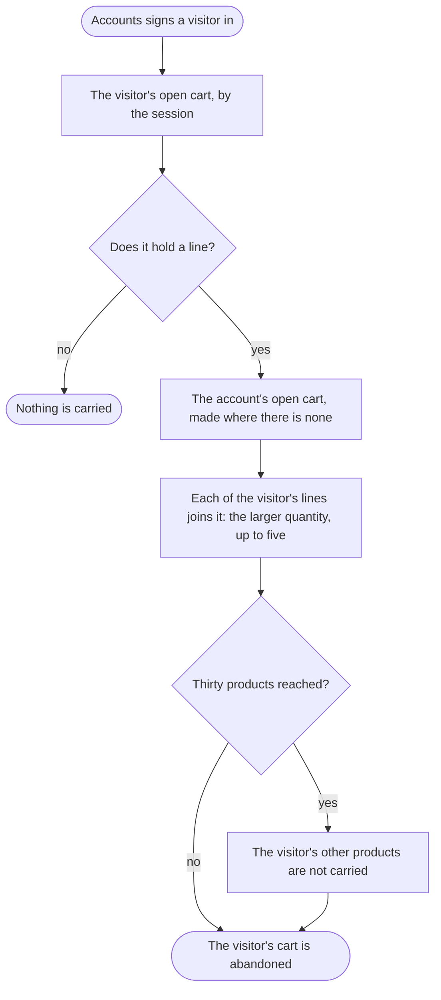

When a visitor signs in, what they put in the cart joins the account's cart, and the visitor's cart is let go.

## Diagram

## Steps

1. Accounts asks the cart for the visitor's open cart, by the session. A9, R7
2. Where it holds no line, nothing is carried and the sign-in goes on. R7
3. Accounts asks for the account's open cart, made where there is none. A9, R7
4. Accounts asks the cart to carry the visitor's lines into it: of a product in both, the larger quantity, up to five; none past the thirtieth product. A6, R7
5. The visitor's cart is abandoned, and the customer's page reads the account's cart from then on. A6, A1, R1

## When it goes wrong

| What fails | Then | Seen by | Stands on |
|---|---|---|---|
| the account's cart holds thirty products already | the visitor's other products are not carried, B2 | the customer, who finds them missing from the cart | B2 |
| a product of the visitor's is gone from the catalogue | its line is carried as it is, answered by its slug and not in stock, R1 | the customer, on the cart page | R1 |
| the sign-in fails before the cart is carried | nothing is carried; the visitor's cart stays the session's until its 48 hours are up, B8 | the visitor, who still has their cart | B8 |
