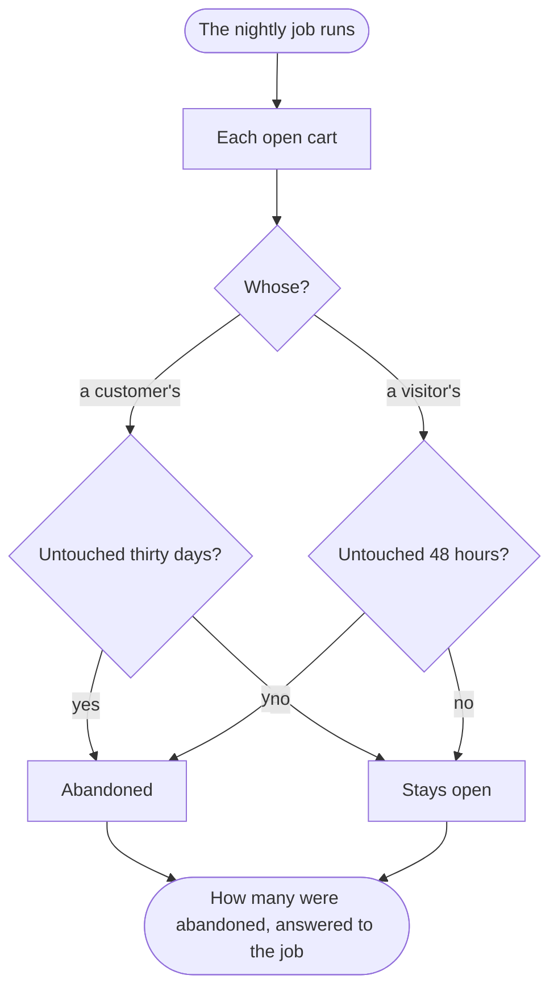

Each night, the open carts nobody has touched for their time are abandoned, and their number counted.

## Diagram

## Steps

1. The nightly job asks the cart to let go of the carts nobody touched. A8, R9
2. Each customer's open cart untouched for thirty days, and each visitor's untouched for 48 hours, is abandoned. A8, R9
3. A checked-out cart is not touched: it is an order's record, B6. A8, R9
4. The number abandoned is answered to the job. A8, R9

## When it goes wrong

| What fails | Then | Seen by | Stands on |
|---|---|---|---|
| the job does not run one night | the carts past their time are let go at the next run, a night late | the job, whose next count is larger |  |
| the job runs twice in one night | the second run finds nothing more to let go, and answers 0 | the job's count |  |
