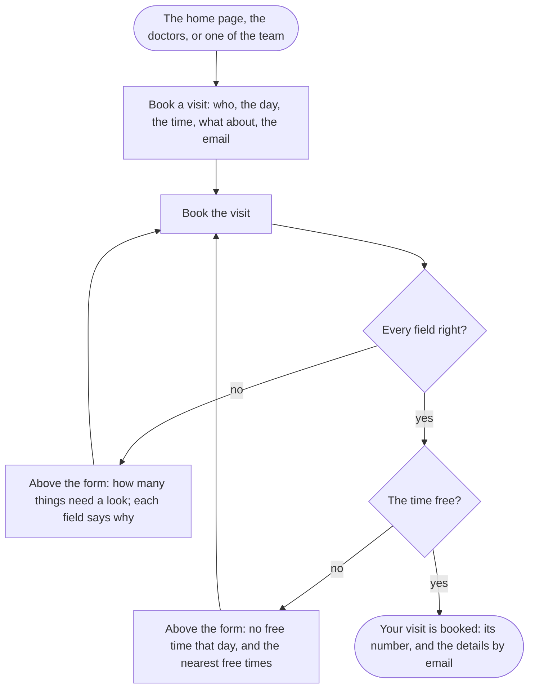

A visitor or a patient ends with a visit booked with the one they chose, its number on the screen and its details in their email.

## Diagram

## Steps

1. The visitor opens the team from the menu and one of them, or goes straight to Book a visit. SC2, SC3, R1
2. From the page of one of the team, Book a visit with opens the form with that one chosen. SC3, SC4, R4
3. They choose the one to see, a day from tomorrow to three months ahead and one of that one's usual times, say what it is about, give their email, and select Book the visit. SC4, R2
4. A day that has passed, a time not chosen or an email that is not one is refused, field by field, with what was typed kept; they correct it and send again. SC4, R3
5. A day with no free time is said above the form with the nearest free times; they choose another and send again. SC4, R3
6. The visit is booked: its number, with whom, when, what about and where; the details go to their email, and a first visit sets up their account. SC4, R2
7. The day before, a text message reminds them, outside the site. R7
