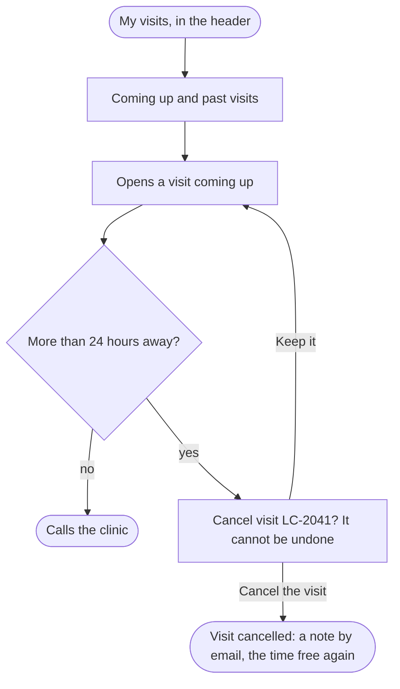

A patient who cannot come ends with the visit cancelled and its time free for someone else, or knows to call the clinic when it is too late for the site.

## Diagram

## Steps

1. The patient opens My visits from the header and sees the visits coming up and the past ones. SC5, R5
2. They open a visit coming up: with whom, when, what about, where. SC6, R5
3. More than 24 hours before it starts, they select Cancel this visit; later, the page tells them to call the clinic, which they do outside the site. SC6, R6
4. The site asks whether to cancel it, saying the time goes to someone else and it cannot be undone; Keep it leads back. SC7, R6
5. They select Cancel the visit: the visit is cancelled, a note goes to their email, and it shows as cancelled under Past visits. SC7, SC5, R6
