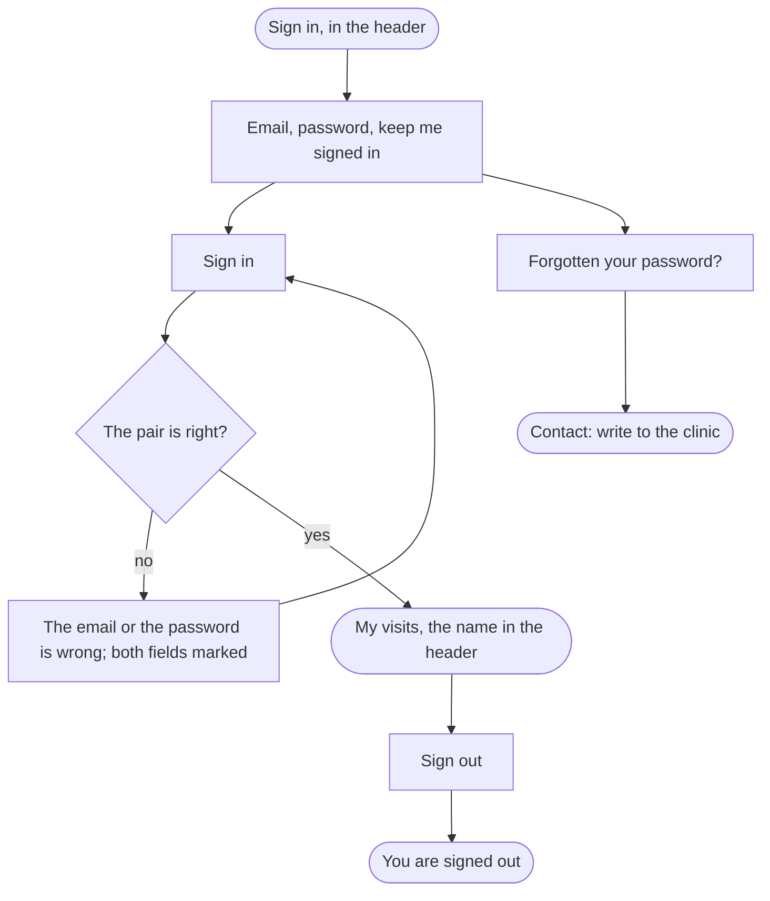

A patient with an account ends signed in, with their visits in front of them.

## Diagram

## Steps

1. The patient opens Sign in from the header. SC8, R8
2. They type the email and the password, tick Keep me signed in on this device where they want it, and select Sign in. SC8, R8
3. A wrong pair is refused above the form, both fields marked and the email kept; they try again. SC8, R8
4. Signed in, My visits opens, and the header shows My visits, their first name and Sign out. SC5, R8
5. Having forgotten the password, they follow Forgotten your password? to Contact and write to the clinic. SC11, R8
6. Done, they select Sign out, and the site says they are signed out. SC9, R9
