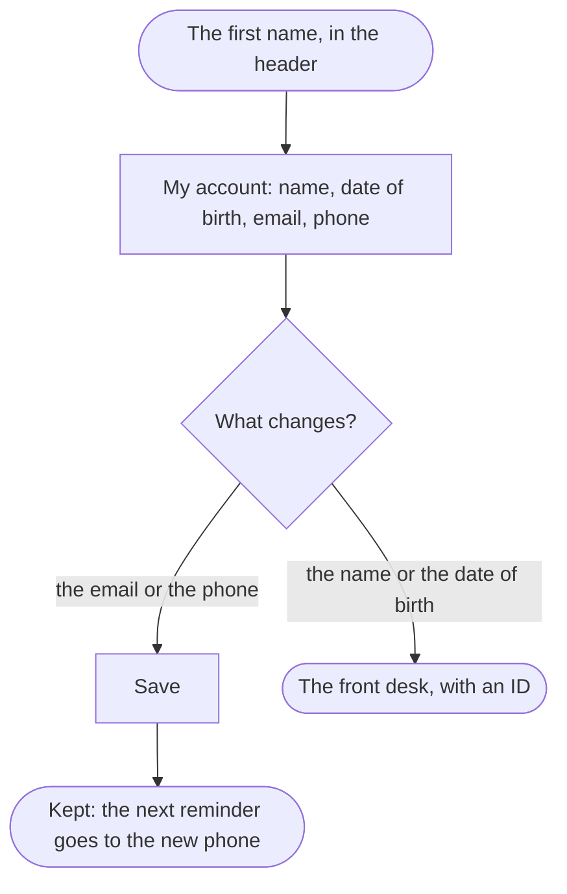

A patient ends with the email and the phone the clinic reaches them on as they want them, so the confirmation and the reminder reach them.

## Diagram

## Steps

1. The patient selects their first name in the header, and My account opens with what the clinic holds. SC10, R10
2. They change the email or the phone and select Save; the account keeps them. SC10, R10
3. A name or a date of birth they change at the front desk, with an ID, outside the site. R10
4. The next reminder goes to the phone kept. R7
