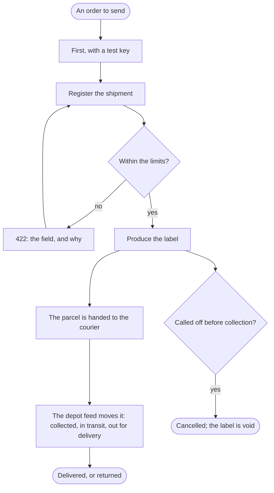

The integrator's program, with an order to send, ends with the parcel delivered and every move of it told to the shop.

## Diagram

## Steps

1. The integrator starts with a test key: its shipments are never collected and its labels say TEST. A5, R11
2. The shop's program registers the shipment with the sender, the recipient, the parcel and the service; one over a limit is refused with the field and why, and is sent again. A1, R1
3. A key that lacks the scope is refused with the scope it lacks: the shop's site, whose key may only read, registers nothing. A1, R6
4. The shop's program produces the label, and the warehouse prints the A6 PDF and sticks it on the parcel; the subscribers hear labelled. A5, A10, R2, R8
5. Called off before the courier has it, the shipment is cancelled, its label void; once collected, the cancel is refused. A6, R3
6. The parcel is handed to the courier, and the depot feed moves the shipment, collected, in transit, out for delivery; each move is told to the subscribers. A10, R8
7. The shop's site asks for the shipment's events and shows them to its customer. A4, R4
8. The shop's program finds a shipment again by its order's reference, among its shipments newest first. A2, R5
9. The parcel is delivered, or returned after three attempts or a refusal. A10, R8
