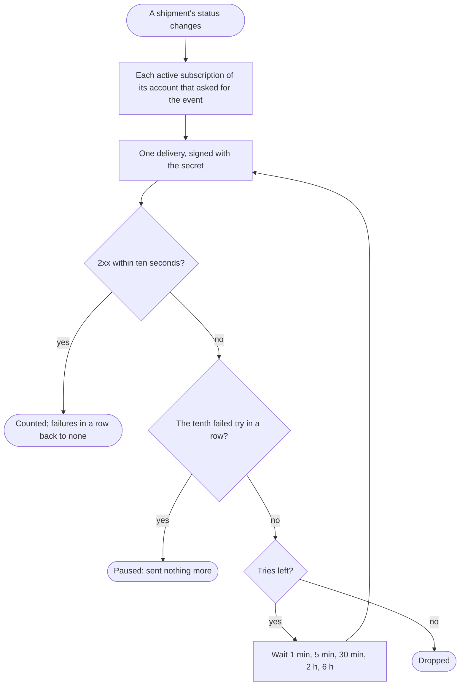

Parcelpost, when a shipment's status changes, ends with each subscriber that asked for it told once, or the subscription paused.

## Diagram

## Steps

1. Parcelpost finds each subscription of the shipment's account that is active and asked for shipment.status.changed. A10, R8
2. It sends each one delivery: the shipment's id, reference, status and service and its last event, signed with the subscription's secret. A10, R8
3. The subscriber checks the signature and answers 2xx within ten seconds; the delivery counts, and the failures in a row are none again. A10, R8
4. Otherwise the try failed, and the delivery is tried again after 1 minute, 5 minutes, 30 minutes, 2 hours and 6 hours, then dropped. A10, R9
5. At the tenth failed try in a row, the subscription is paused and sent nothing more, and the account's technical contact is emailed that day. R9, R10
6. The integrator sees it not active in the list of subscriptions, stops it and subscribes again. A8, A9, A7, R7

## When it goes wrong

| What fails | Then | Seen by | Stands on |
|---|---|---|---|
| the subscriber answers other than 2xx, or nothing within ten seconds | the delivery is tried again five times, after 1 minute, 5 minutes, 30 minutes, 2 hours and 6 hours, then dropped, R9 | the subscriber, by X-Parcelpost-Attempt above 1; Parcelpost's log, a line for each failed try | R9 |
| ten tries in a row fail | the subscription is paused, and what happens while it is paused is never sent, R9 | the integrator, in the list of subscriptions, A8: not active, with its failures; the account's technical contact, by email, R10 | A8, R9, R10 |
| the signature does not match at the subscriber | the subscriber refuses the delivery, and Parcelpost counts the refusal as a failed try, R9 | the subscriber's own log | R9 |
| the subscription was stopped | nothing more is sent to it, R7 | the integrator, who no longer finds it in the list, A8 | R7, A8 |
