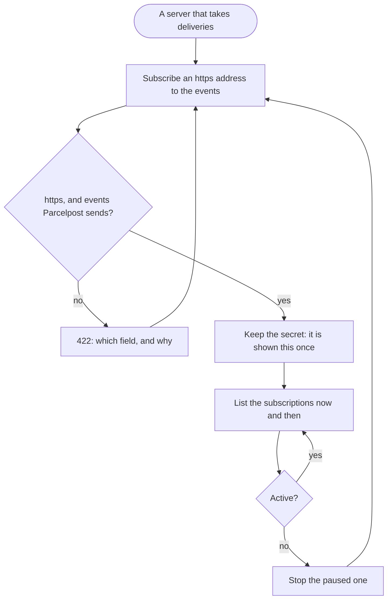

The integrator, with a server that takes deliveries, ends with a subscription that is active and a secret kept where the server checks signatures with it.

## Diagram

## Steps

1. The integrator subscribes an https address to shipment.status.changed, shipment.delivery.attempted, or both; an http address or an event Parcelpost does not send is refused. A7, R7
2. The integrator keeps the secret the answer holds, since it is never shown again, and the server checks each delivery's signature with it. A7, R7, R8
3. The integrator lists the subscriptions, each with whether it is active and its failures in a row. A8, R7
4. A paused subscription is stopped, and the address subscribed again, with a new secret; a paused one cannot be resumed. A9, A7, R7, R12
