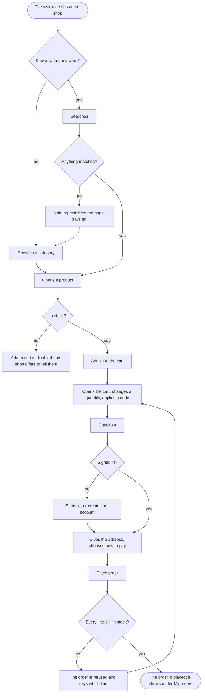

A visitor, come for something, ends with an order placed and the shop's word that it is on its way.

## Diagram

## Steps

1. The visitor arrives at the home page and opens a category, or searches; a category lists its products four to a page, and a search says how many match or that nothing does. SC1, SC2, SC4, R1, R3
2. The visitor opens a product and reads its price, its stock and its reviews; a product out of stock has Add to cart disabled. SC3, R2
3. The visitor chooses a quantity and selects Add to cart; the shop adds the line, or refuses a sixth of the same product. SC3, A4, R4
4. In the cart the visitor changes a quantity, removes a line, or applies a code, and reads the subtotal, the delivery and the total. SC5, A3, R5
5. The visitor selects Checkout; signed out, they sign in first, F2, or create an account, F3, and come back to the checkout with the same cart. SC7, SC8, R6
6. At the checkout the customer gives the delivery address, chooses Card, PayPal or Invoice, and selects Place order; the shop makes the order, placed, and empties the cart. SC6, A6, R6
7. If a line is no longer in stock, the shop refuses the order and says which line; the customer changes the cart. SC6, A6, R6
8. The order shows under My orders, placed; the customer follows it there, F5. SC12, R12
