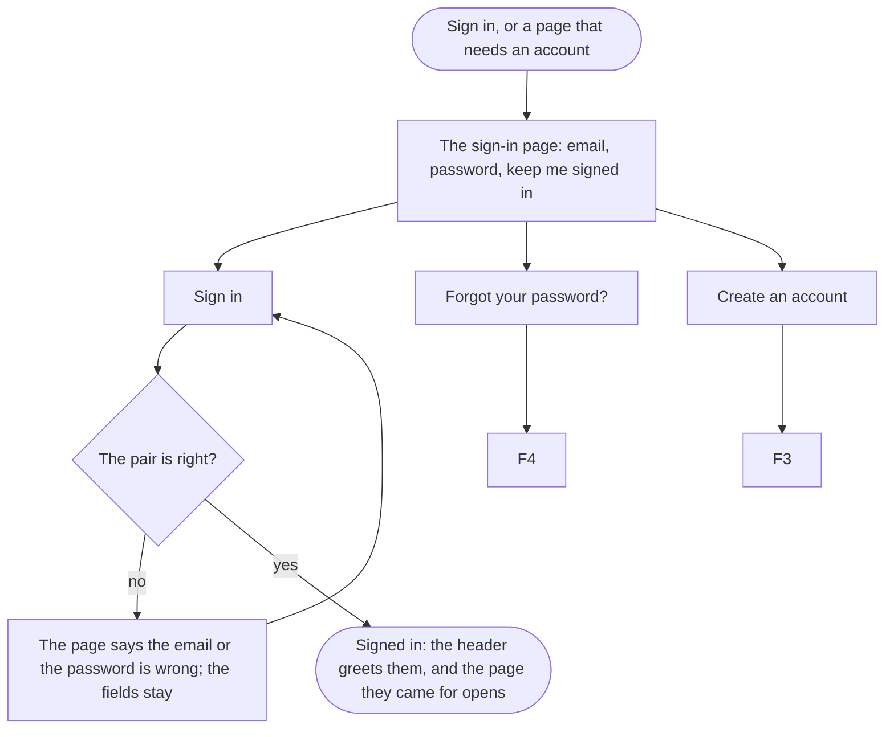

A visitor with an account ends signed in, where they were, with their cart.

## Diagram

## Steps

1. The visitor opens Sign in from the header, or is sent there by a page that needs an account. SC7, R7
2. They type the email and the password, tick Keep me signed in where they want it, and select Sign in. SC7, A9, R7
3. A wrong pair is refused above the form, with both fields marked and what was typed kept; they try again. SC7, A9, R7
4. Signed in, the header greets them by name, their visitor's cart is now the account's, and the page they came for opens: the checkout, or the profile. SC6, SC11, R7
