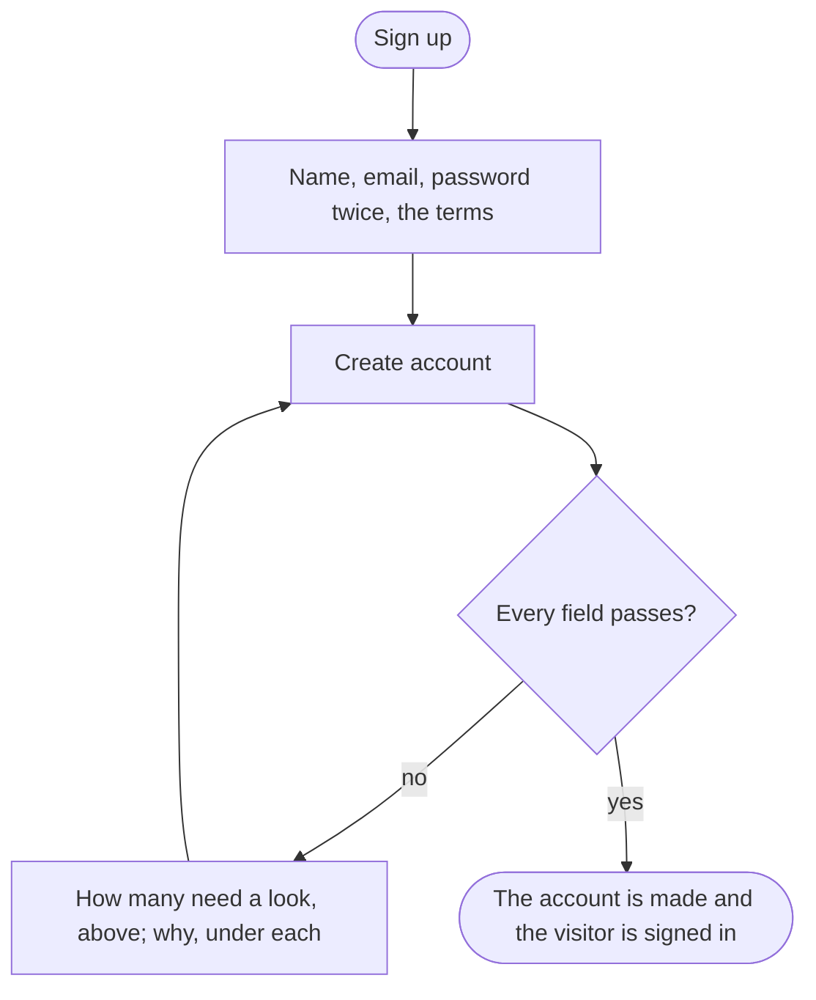

A visitor without an account ends with one, signed in.

## Diagram

## Steps

1. The visitor opens Sign up from the header, or Create an account from the sign-in page. SC8, R8
2. They type their name, their email, a password twice, tick the terms, and select Create account. SC8, A11, R8
3. A field wrong is refused: the page says how many need a look above the form and why under each field, and keeps what was typed. SC8, A11, R8
4. The account is made and the customer is signed in; the page they came for opens. SC11, R8
