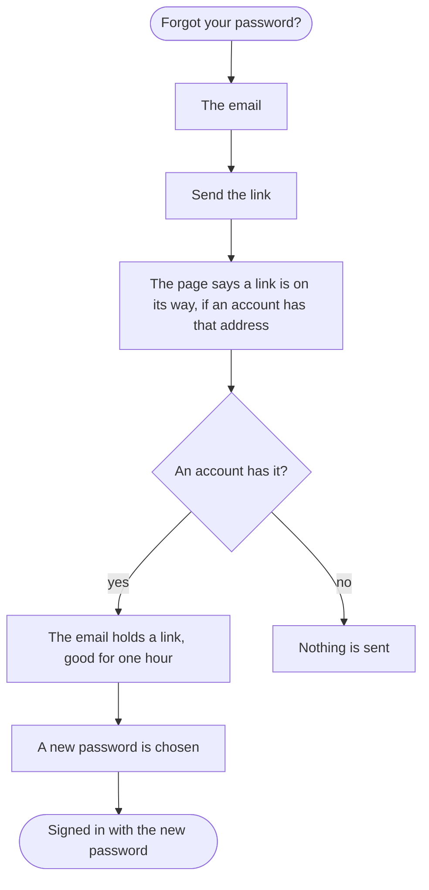

A customer who has forgotten their password ends with a new one, by a link the shop sends.

## Diagram

## Steps

1. The visitor opens Forgot your password? from the sign-in page and types their email. SC9, R9
2. They select Send the link; the page says that a link is on its way if an account has the address, and that it works for one hour, whether or not one does. SC9, R9
3. Where an account has the email, the link arrives; opened within the hour, it leads to choosing a new password. Outside the shop's pages: the email.
4. With the new password the customer signs in, F2. SC7, R7
