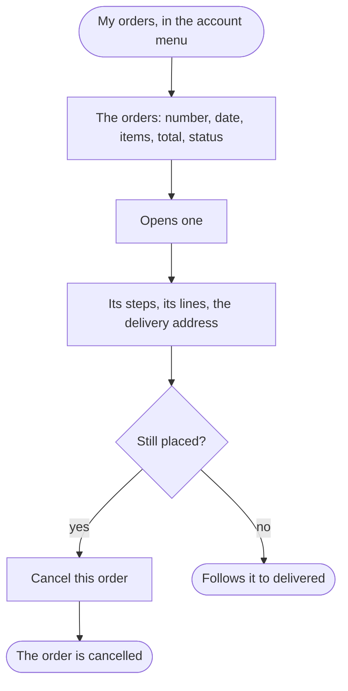

A customer with an order placed ends knowing where it stands, and has cancelled it while that was still possible.

## Diagram

## Steps

1. The customer opens My orders from the account menu and reads their orders, newest first. SC12, A5, R12
2. They open an order: its status, the four steps with the one reached, its lines and the delivery address. SC13, A7, R12
3. While the order is placed, Cancel this order is offered; selecting it cancels the order. SC13, R12
4. From paid on there is nothing to do but wait: the admin moves the order, F6, and the steps show where it stands. SC13, R12
