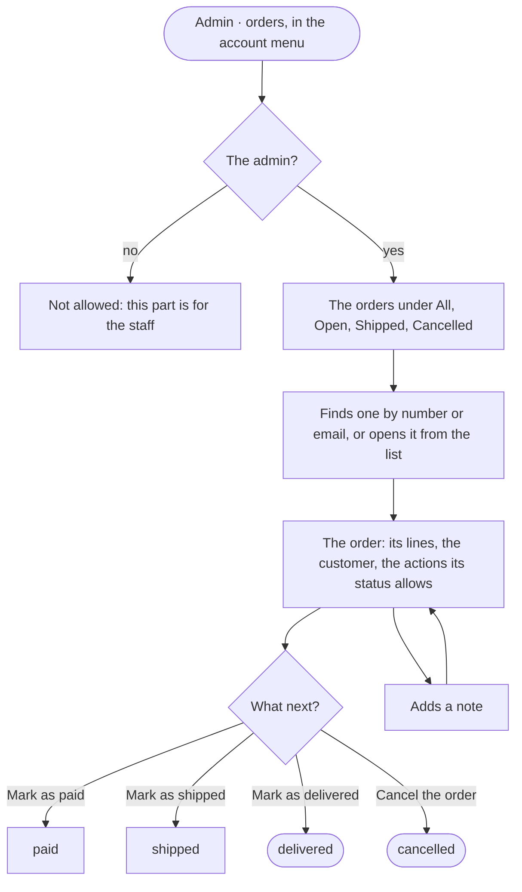

The admin, with orders placed, ends with each paid, shipped and delivered, or cancelled, with a note where one was needed.

## Diagram

## Steps

1. The admin opens Admin · orders from the account menu; a customer who is not the admin gets the door instead. SC14, SC16, R14
2. The admin reads the orders under All, Open, Shipped or Cancelled, each with its count, or finds one by number or email. SC14, R13
3. The admin opens an order: its lines, the customer, and the actions its status allows. SC15, A7, R13
4. The admin marks the order paid, shipped or delivered, or cancels it; a move the status does not allow is refused. SC15, A8, R13
5. The admin adds a note where one is needed; it stays on the order. SC15, R13
