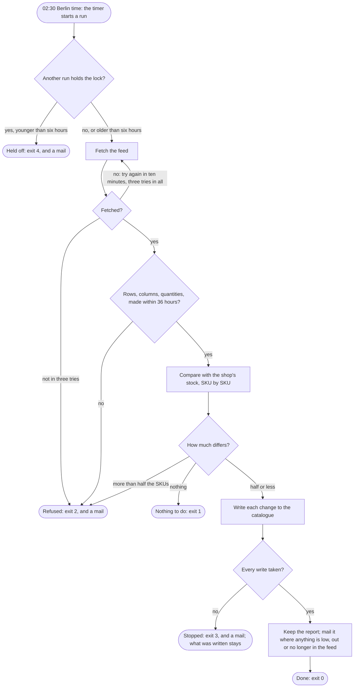

The timer starts the job; by the morning the shop's stock matches the supplier's feed, or the operator on call has a mail that says why it does not.

## Diagram

## Steps

1. At 02:30 Berlin time, or up to five minutes after, the timer starts a run; a night missed while the host was down runs when it is up again. A1, R1
2. The run takes the lock; where another run holds one younger than six hours, it ends held off, says so in the log and mails the morning. A1, R7, R6
3. The run fetches the feed, and where the supplier answers 503 or nothing, tries again ten minutes later, three tries in all. A1, R2
4. The run checks the feed: its rows, its three columns, its quantities, and that it was made within 36 hours; a feed that fails is refused and nothing is written. A1, R3
5. The run compares the feed with the shop's stock, SKU by SKU, passing over what the shop does not sell; where nothing differs it ends with nothing to do, and where more than half would change it is refused. A1, R5, R4
6. The run writes each change to the catalogue; where the catalogue refuses one, it stops, and what was written stays. A1, R5
7. The run keeps the report, mails it where any SKU is low, out of stock or no longer in the feed, writes its last line to the log, and gives the lock back. A1, R6, R10, R11
8. At 08:00 the operator on call reads the mail; a night without one went as it should.

## When it goes wrong

| What fails | Then | Seen by | Stands on |
|---|---|---|---|
| the supplier answers 503 while it rebuilds the feed | tried again ten minutes later, three tries in all, then refused with exit 2, R2 | a line per try in the log, and a mail that says FAILED | R2 |
| the feed is empty, out of shape or more than 36 hours old | refused whole with exit 2; nothing written, R3 | the log's last line and a mail, each with the reason | R3 |
| the feed would change more than half the shop's SKUs | refused whole with exit 2; nothing written, R4 | a mail with how many would change of how many | R4 |
| the catalogue refuses a write | stopped with exit 3; the writes before it stay, R5 | a mail naming the SKU; the operator reruns, F2 | F2, R5 |
| the catalogue does not answer with the shop's stock | stopped with exit 5, R6 | a mail that says FAILED, where today there is none | R6 |
| a run before still holds the lock | held off with exit 4, R7 | a line in the log and a mail | R7 |
| the run is still going at 45 minutes | stopped by the host, R1 | a mail that says FAILED, R6 | R1, R6 |
