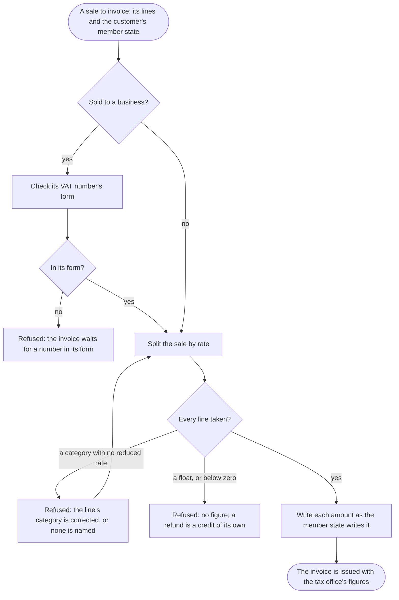

The shop's invoicing, with a sale to invoice, ends with every figure the invoice shows, to the cent, written as the customer's member state writes it.

## Diagram

## Steps

1. The invoicing has a sale to invoice: its lines, each a net price with its category or none, and the customer's member state.
2. For a sale to a business, the invoicing gives vatkit the customer's VAT number and takes it back as it is filed; a number out of its form is refused, and the invoice waits for one in its form. A8, R7
3. The invoicing gives vatkit the sale's lines and its member state, and takes for each rate, highest first, the net, the VAT computed once on the sum, and the gross. A5, R5
4. If a line's category has no reduced rate in that member state, the whole sale is refused; the invoicing corrects the category, or names none for the standard rate, and splits it again. A5, A1, R1
5. If a net price is a float or below zero, the sale is refused and no figure is given; a refund is invoiced as a credit of its own. A5, R8
6. Where the invoice shows one price with its VAT, the invoicing takes the VAT on its net, the gross from its net, or the net in its gross. A2, A3, A4, R2, R3, R4
7. The invoicing writes each amount as the member state writes it, and issues the invoice. A6, R6
