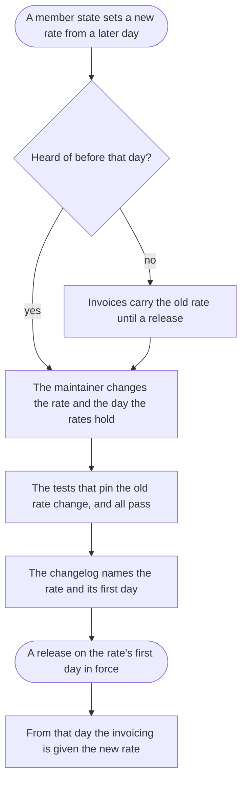

The maintainer, told that a member state changes a rate, ends with a release of vatkit that gives the new rate from its first day in force.

## Diagram

## Steps

1. A member state sets a new rate from a later day; the Commission's notices tell the maintainer and the finance lead.
2. The maintainer changes the rate in vatkit, and the day its rates hold to the new rate's first day in force. B8 R10
3. The maintainer changes the tests that pin the old rate and runs them all; none is left skipped for the change. R10
4. The maintainer names the rate and its first day in the changelog, and publishes the release on that day, a minor version, since no function's name or what it takes changes. R10
5. From that day the invoicing asks the rate of that member state and is given the new one. A1, R1

## When it goes wrong

| What fails | Then | Seen by | Stands on |
|---|---|---|---|
| the change is heard of after its first day in force | every invoice to that member state carries the old rate until a release carries the new one, and each is corrected by hand with a credit note, R10 | the finance team, or a customer: 214 invoices to Finland in January 2026 (E80) | R10, E80 |
| a test of the change is skipped and the release waits | the rates lag the law, as the skipped test of 2026 says, Q1 | the maintainer, by the skipped test (E60) | Q1, E60 |
| the invoicing takes the release a day after it is published | invoices of that day carry the old rate, Q2 | the finance team, on the invoices of that day | Q2 |
