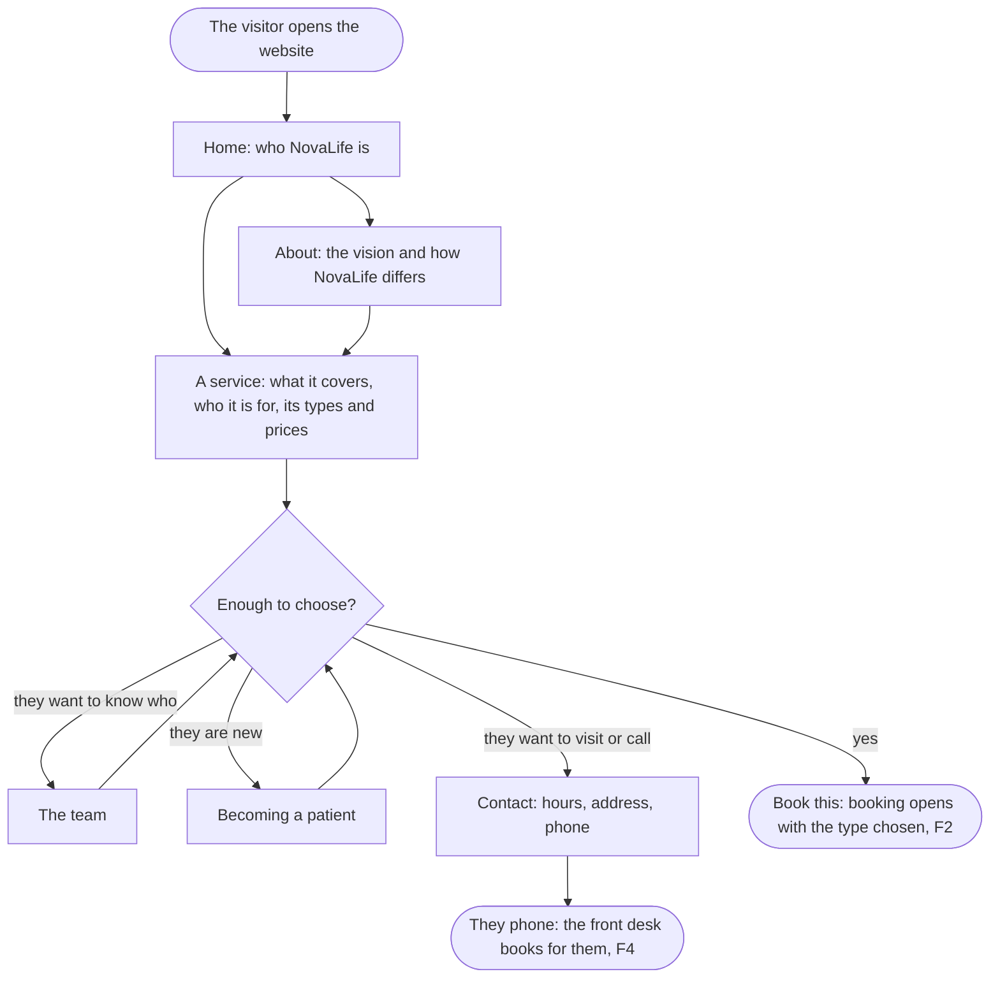

A visitor who has heard of NovaLife finds out what it is, what each service covers and costs, who works there and how to become a patient, and goes on to book.

## Diagram

## Steps

1. The visitor opens the website and reads the clinic's name, tagline, mission and central idea. SC1, R1
2. They choose a service, and read what it covers, who it is for, and its appointment types with their prices, which patients pay themselves. SC2, R2, R7
3. They read how NovaLife differs from the traditional approach, and its vision with its limit. SC3, R3, R4
4. They see the clinicians who work there. SC4, R8
5. They read how to become a patient, what happens at the first visit and what to bring. SC5, R9
6. They find the hours, the address and the phone. SC6, R5
7. They phone instead: the front desk books for them, F4. This step is outside the website.
8. They choose Book this on an appointment type, and booking opens with it chosen, F2. SC8, R6
