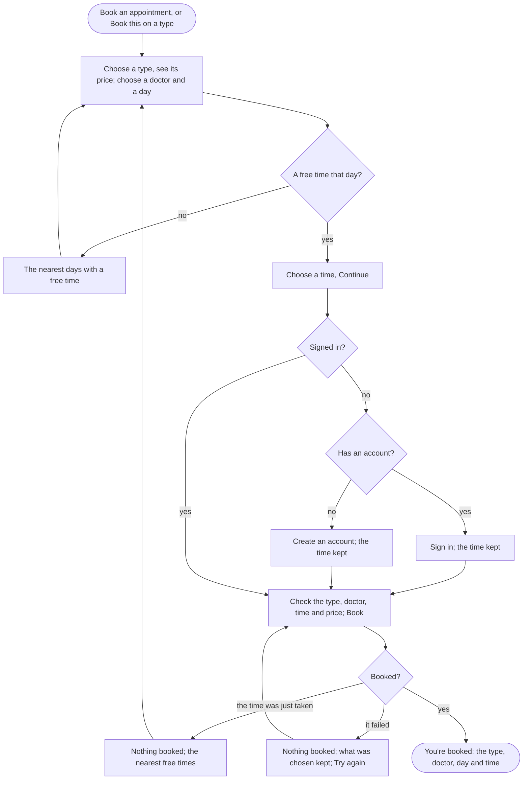

A visitor books an appointment type with a doctor at a free time, signing in or creating an account on the way, and has it confirmed on the next screen.

## Diagram

## Steps

1. The visitor chooses an appointment type and sees its price; booking asks for no medical details, and says it is not for emergencies. SC8, R6, R7, R11
2. They choose a doctor who gives the type, or any, and a day; booking shows the free times, or, with none that day, the nearest days that have one. SC8, R14, R6
3. They choose a time and Continue; Continue with no time asks for one. SC8, R6
4. Signed out, they sign in, and the time is kept. SC9, R16, R6
5. New to NovaLife, they create an account with their name, date of birth, email, phone and a password, and the time is kept. SC21, R16, R6
6. They check the type, the doctor, the time and the price, which they pay themselves at the visit, and book. SC10, R6, R7
7. If the time was just booked by someone else, nothing is booked, and the nearest free times show. SC10, R6
8. If the booking fails, nothing is booked, what was chosen is kept, and they try again. SC10, R6
9. The next screen confirms it: the type, the doctor, the day and the time. SC11, R6
