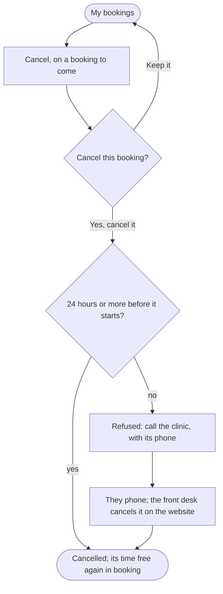

A patient cancels a booking to come, online up to 24 hours before it starts, or by phoning the clinic after that, and its time is free for others again.

## Diagram

## Steps

1. The patient opens My bookings and sees those to come and those past. SC12, R17
2. They choose Cancel on a booking to come, and confirm it. SC12, R15
3. At least 24 hours before it starts, it is cancelled, shows under Past as cancelled, and its time is offered in booking again. SC12, R15
4. Less than 24 hours before, the website refuses, and gives the clinic's phone. SC12, R15
5. They phone the clinic. This step is outside the website.
6. The front desk finds the booking and cancels it, however close to its start. SC14, R15
7. To change the time, they cancel and book again: a booking is never moved. SC8, R15
