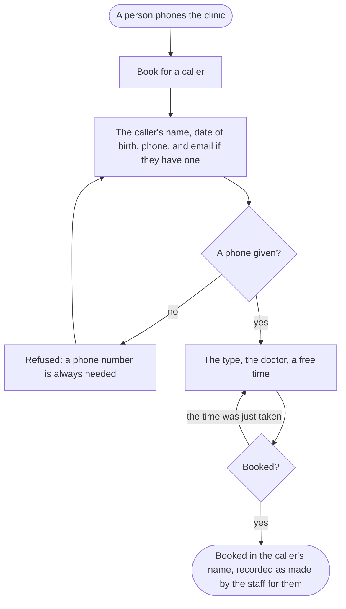

A person phones the clinic, and the front desk books for them on the website, in their name, so that every booking is made in one place.

## Diagram

## Steps

1. A person phones the clinic to book. This step is outside the website.
2. The front desk, signed in, opens Book for a caller. SC13, R12
3. They write the caller's first and last name, date of birth and phone, and their email where they have one; with no phone, the website refuses. SC15, R6
4. They choose the type, the doctor and a free time, as in booking. SC15, R6, R14
5. They book: it is made in the caller's name, as if the caller had booked it, and recorded as made by the staff for them. SC15, R6
6. A caller with no email has no account, and cancels by phoning: the front desk cancels it on Bookings. SC14, R15
