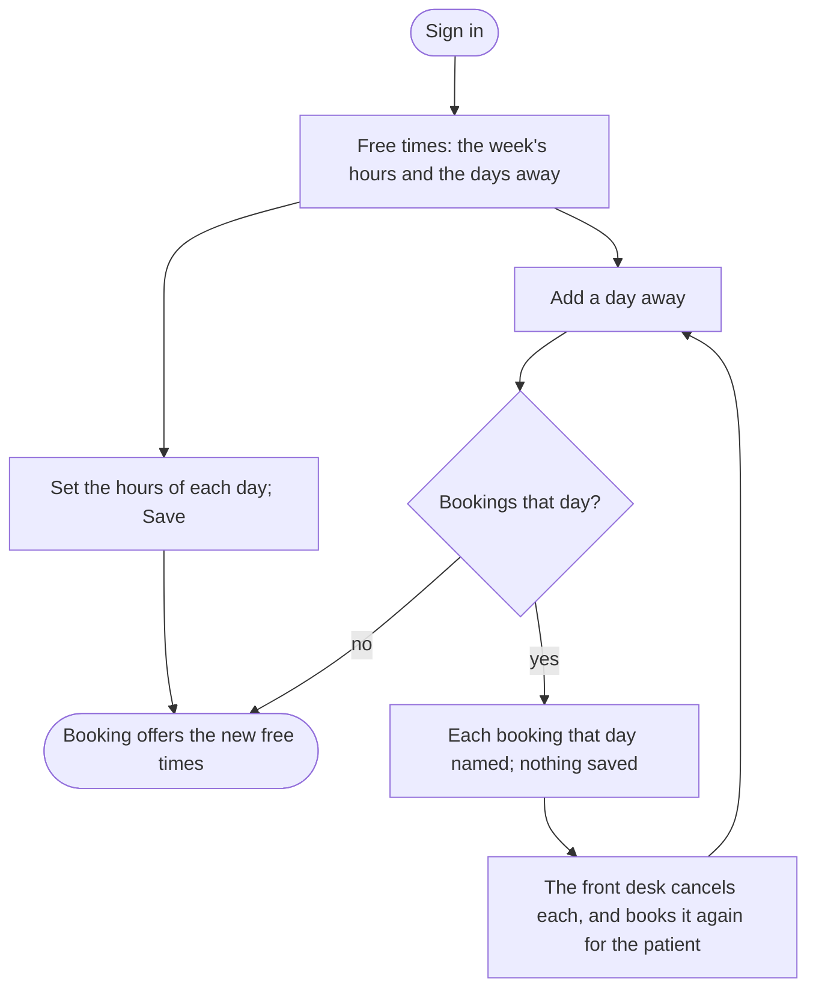

A doctor sets the hours they see patients each week and the days they are away, so that booking offers only times they are free.

## Diagram

## Steps

1. A doctor signs in, and the staff area opens on Free times. SC13, R12
2. They see their own week alone; the front desk or an administrator chooses any doctor. SC16, R14, R18
3. They set the hours of each day they see patients, and save; booking offers each slot of those hours less those booked. SC16, R14
4. They add a day away; booking offers none of their times that day. SC16, R14
5. If they have bookings that day, the website names them, and saves the day only once each is cancelled. SC16, R14
6. The front desk cancels each, and books it again for the patient on another day. SC14, R15
