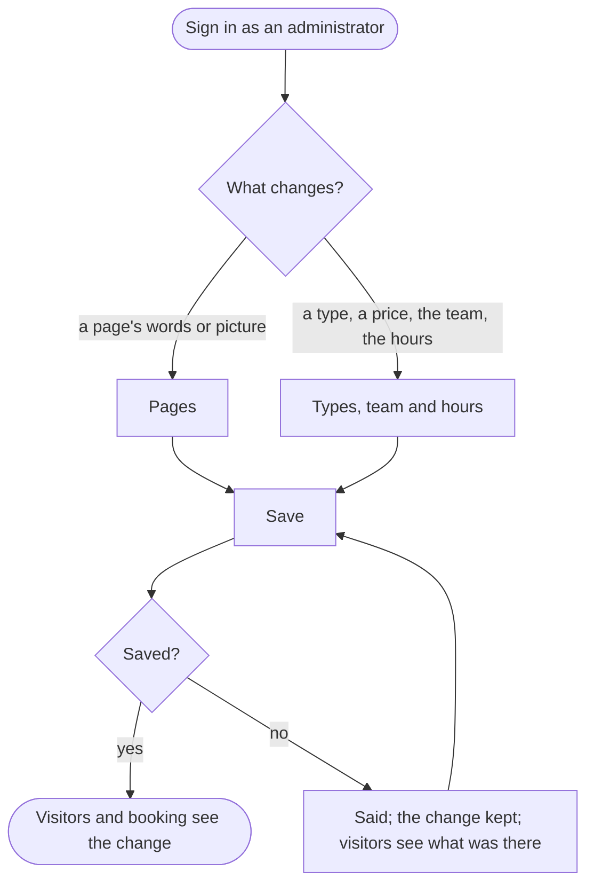

An administrator changes the words and pictures of the website, the appointment types and their prices, the team and the opening hours, and visitors see the change once it is saved.

## Diagram

## Steps

1. The administrator signs in. SC13, R12
2. They open Pages, choose a page, and change its words or its picture. SC17, R13
3. Or they open Types, team and hours, and add or change an appointment type with its price and doctors, a clinician, or the hours. SC18, R13
4. They save, and visitors see the change: the service's page, booking, the Team page, the Contact page. SC2, R13, R7
5. If the save fails, the website says so, keeps the change written, and visitors still see what was there before. SC17, R13
6. Leaving with a change not saved, the browser asks before it is lost. SC17, R13
7. The front desk or a doctor who opens these pages is refused. SC17, R18
