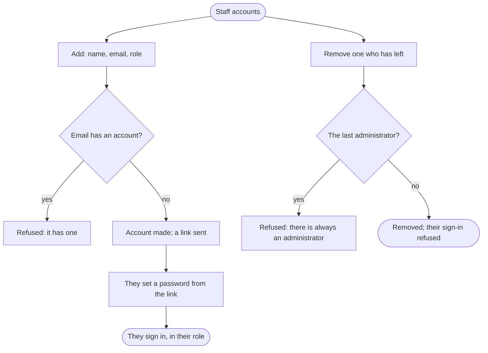

An administrator adds a member of staff with their name, email and role, who sets a password from the link they are sent and signs in; and removes one who has left.

## Diagram

## Steps

1. The administrator opens Staff accounts. SC19, R19
2. They add a member of staff with their name, email and role; an email that has an account is refused. SC19, R19
3. The new member receives an email with a link. This step is outside the website.
4. They set their password from the link. SC20, R19
5. They sign in, and see what their role allows. SC13, R12, R18
6. The administrator removes one who has left, whose sign-in is refused from then on; the last administrator cannot be removed. SC19, R19
